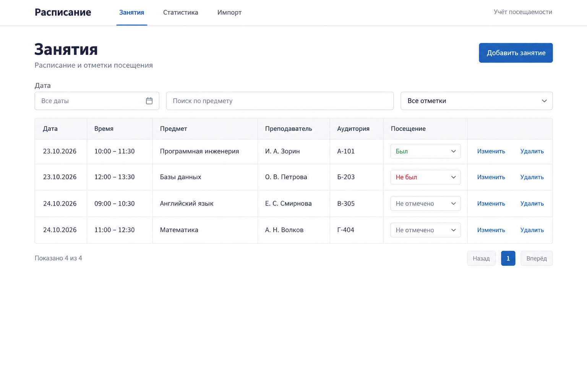

# Расписание

Веб-приложение для расписания занятий и учёта посещаемости. Панченко.

## Лаба 1 — визуальный дизайн



Студент загружает расписание из HTML, просматривает занятия, исправляет записи,
отмечает посещение и смотрит статистику по предметам.

Три раздела: «Занятия», «Статистика» и «Импорт». Форма добавления и изменения
занятия содержит дату, время, предмет, преподавателя и аудиторию.

Отметка посещения имеет три состояния: «Был», «Не был», «Не отмечено».
В процент посещаемости входят только занятия с отметкой.

Макет создан встроенным генератором изображений. Интерфейс следующих лаб
реализуется обычными HTML и CSS; изображение служит макетом.

## Лаба 2 — интерфейс

Angular 20, TypeScript, обычный CSS. У каждого компонента своя папка и отдельные
файлы `.ts`, `.html`, `.css`. Маршруты переключает Angular Router; свойства
и события связывают шаблон с компонентом.

```sh
cd client
pnpm install --frozen-lockfile
pnpm start
```

Открыть http://localhost:4200. Требуются Node.js 20.19+, 22.12+ или 24 и pnpm 11.
Команда `pnpm build` собирает приложение.

Компоненты вызывают `LessonsService`: список, создание, изменение, удаление,
отметки посещения, импорт и статистика. В этой лабе сервис хранит тестовые данные
в памяти браузера: после обновления страницы изменения сбрасываются.
Формат HTML сохранён из прежнего приложения; пример доступен в разделе импорта.
